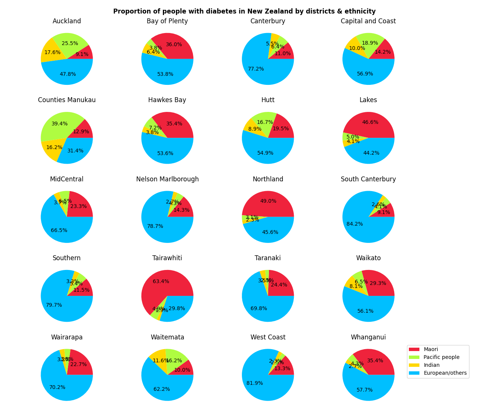
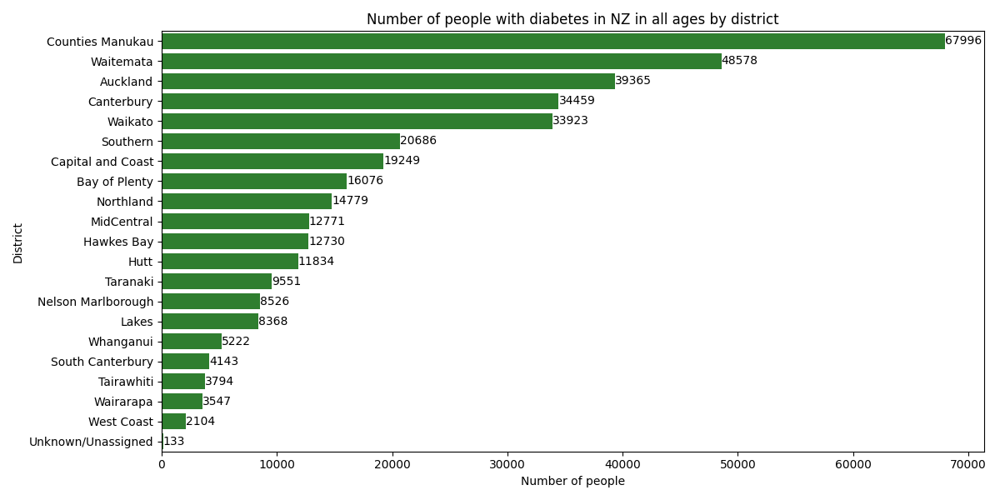
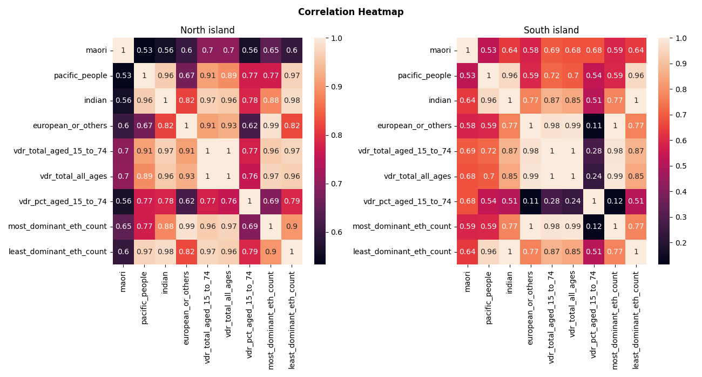

# Data Analysis of Diabetes Prevalence in New Zealand using VDR

  
  
  
  

VDR (Virtual Diabetes Register) is a tool used for tracking the number of people living with diabetes in New Zealand. This notebook used a dataset which has the VDR details taken in the year 2025. Diabetes is a medical condition where there is high blood sugar which makes the human body unable to produce insulin or use if effectively. There are different types of diabetes such as:

- Type 1 Diabetes
- Type 2 Diabetes
- Gestational Diabetes
- Prediabetes

## 🖼️Tableau Dashboard

### 💻Interactive dashboard
View the interactive dashboard on <a href="https://public.tableau.com/app/profile/reshma.haridhas/viz/DiabetesVDR/Dashboard1">Tableau Public</a>

## 📓Kaggle Notebook
https://www.kaggle.com/code/reshmaharidhas/diabetes-prevalence-in-new-zealand-eda

## 💻Analysis Workflow
- Exploratory Data Analysis
- Data cleaning
- Exporting cleaned dataset
- Data visualization
- Key insights
- Dashboard design

## 💻Tech Stack
- Python
- Pandas
- Numpy
- Matplotlib
- Seaborn
- Plotly
- Tableau

## 📊Visualizations

## 🗂️Dataset
- Source: Kaggle
- Dataset url: https://www.kaggle.com/code/reshmaharidhas/diabetes-prevalence-in-new-zealand-eda
- Size: 21 rows

## 💻License
MIT
